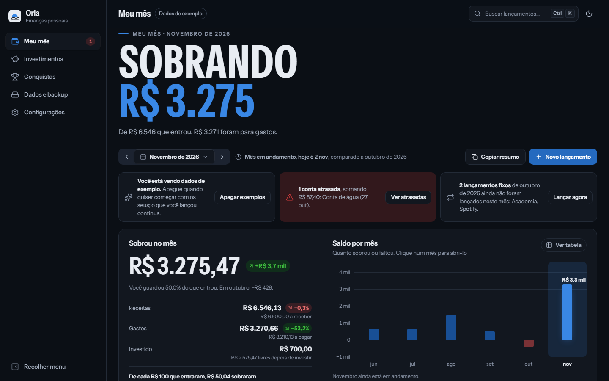
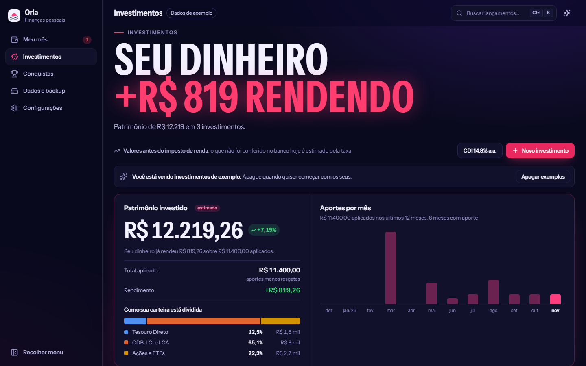
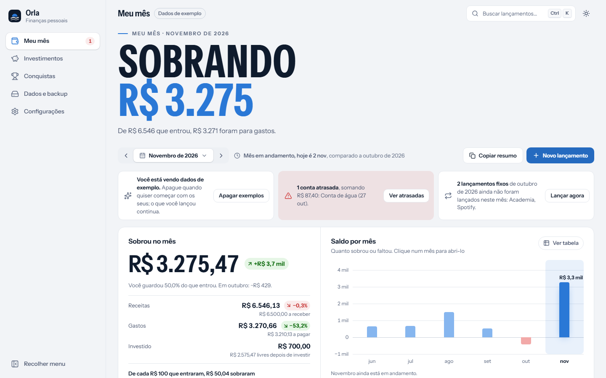
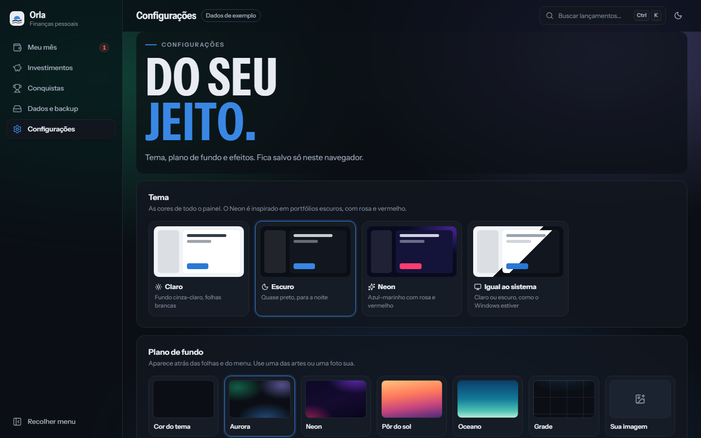

# Orla · Finanças pessoais

Painel para controlar o próprio dinheiro: o que entra, o que sai, quanto sobra no mês, onde está investido e quanto falta para cada meta. Roda no seu computador e guarda tudo num arquivo JSON na pasta do projeto. Seus dados nunca vão para a internet; a única parte que usa conexão são as cotações da bolsa.



> Todos os prints usam os **dados de exemplo** que vêm no próprio painel.

## Destaques

- **Meu mês**: receitas menos gastos, comparação com o mês anterior, saldo dos últimos meses, avisos de contas atrasadas e orçamento por categoria.
- **Lançamentos completos**: parcelas, contas fixas que se repetem, mês da fatura, forma de pagamento, pagar com um clique e desfazer.
- **Investimentos**: carteira com rendimento estimado por % do CDI ou taxa fixa, aportes e resgates, simulador de juros compostos e calculadora de porcentagem.
- **Bolsa ao vivo**: cotações de B3, Nova York, Londres, Frankfurt, Tóquio, Hong Kong, moedas e cripto, com gráfico do dia, e o lucro ou prejuízo das suas ações pela cotação de agora. Funciona quando há internet; sem conexão, mostra as últimas cotações.
- **Conquistas e metas**: 22 conquistas calculadas pelos seus dados, uma linha do tempo com seus marcos e metas com quanto guardar por mês.
- **Do seu jeito**: temas Claro, Escuro e Neon, planos de fundo (inclusive uma foto sua), títulos gigantes animados e um rastro no cursor.
- **Seus dados são seus**: arquivo local com backup diário automático, exportação para planilha e backup em um clique.
- **Sem bibliotecas de gráfico**: as colunas e barras são HTML e CSS, com versão em tabela e navegação pelo teclado.

| Investimentos (tema Neon) | Conquistas (fundo Neon) |
|---|---|
|  |  |

| Meu mês (tema claro) | Configurações |
|---|---|
|  |  |

## Como rodar

Precisa do [Node.js](https://nodejs.org) 20.19 ou mais novo.

```bash
npm install
npm run dev
```

O painel abre em http://localhost:5181. No Windows, também dá para dar dois cliques em **`Iniciar.bat`**, que instala o que precisa na primeira vez e abre o navegador.

Na primeira vez o painel está vazio. Clique em **Ver com dados de exemplo** para explorar, e em **Apagar exemplos** quando quiser começar com os seus.

### Demonstração

A demonstração começa com os dados de exemplo e guarda tudo só no navegador, sem servidor. Dá para publicá-la em qualquer hospedagem estática.

```bash
npm run demo        # para ver no seu PC
npm run build:demo  # gera a pasta dist
```

O workflow em `.github/workflows/demo.yml` publica a demonstração no GitHub Pages a cada push na `main`. Para ligar, abra **Settings → Pages** no repositório e escolha **GitHub Actions** em *Source*.

## Onde ficam os dados

| Onde | O que é |
|---|---|
| `dados/orla-financas.json` | Lançamentos, limites do orçamento, investimentos, compras e vendas de ações e metas |
| `dados/backups/` | Uma cópia por dia, guardando os últimos 30 dias |
| Navegador | Uma cópia de segurança. Se o arquivo não responder, o painel continua salvando aqui. O tema, o plano de fundo e os efeitos ficam só aqui |

A pasta `dados` está no `.gitignore`, então seus lançamentos nunca vão para o repositório.

Para levar os dados para outro PC: **Dados e backup → Baixar backup**. Para voltar: **Restaurar backup**.

## Telas

**Meu mês**
- **Sobrou no mês**: receitas menos gastos, comparado com o mês anterior, e para onde foi cada R$ 100 que entrou.
- **Saldo por mês**: clique numa coluna para abrir o mês (também pelo teclado, com as setas). Tem versão em tabela.
- **Avisos**: contas atrasadas, contas que vencem em até 3 dias e lançamentos fixos do mês passado que ainda não foram lançados.
- **Lançamentos do mês**: busca, filtros (a pagar, atrasados, pagos), categoria, ordenação, pagar com um clique, seleção de vários, excluir com “Desfazer” e copiar para planilha.
- **Orçamento por categoria**: limite mensal de cada categoria, com sugestão pela média dos últimos 3 meses.

**Novo lançamento** (tecla `N`): gasto ou receita, valor, data, descrição com sugestões, categoria, forma de pagamento, compra parcelada, mês em que conta (útil para a fatura do cartão), pago ou não, “repete todo mês” e observação.

**Investimentos**
- **Patrimônio investido**: quanto vale hoje, quanto foi aplicado, quanto rendeu e como a carteira está dividida.
- **Sua carteira**: cada investimento com aportes, resgates e o valor conferido no banco.
- **Valor de hoje**: calculado com juros compostos a partir do último valor conferido, pela taxa informada (% do CDI, % ao ano ou % ao mês). Quando não foi conferido hoje, aparece como “estimado”. Tudo antes do imposto de renda.
- **Simulador** e **calculadora de porcentagem**.
- **Bolsa** (aba ao lado de “Minha carteira”): escolha a bolsa e veja o índice principal, o gráfico do dia com cursor e a lista de ações com a variação do dia. Dá para adicionar qualquer ação, índice ou moeda pela busca e tirar as que não quiser. Atualiza sozinho a cada minuto.
  - **Minhas ações**: registre cada compra e venda (quantidade, preço por cota, data e custos de corretagem). O painel calcula o preço médio, quanto suas cotas valem agora, o lucro ou prejuízo em R$ e em %, a variação do dia e o resultado já realizado nas vendas. Ações em dólar, euro e outras moedas aparecem na moeda original e em reais, pelo câmbio de agora. As operações ficam no arquivo de dados e entram no backup.
  - É a exceção do painel: precisa de internet. Sem conexão, aparece um aviso e ficam as últimas cotações guardadas. O resto do painel continua funcionando normalmente.
  - Os dados vêm do Yahoo Finanças pelo servidor do próprio painel (o navegador não pode chamar o Yahoo direto), sem cadastro nem chave. Por isso a demonstração online, que não tem servidor, não mostra cotações. Algumas bolsas têm atraso de até 15 minutos.

**Conquistas**
- **Placar** com as conquistas desbloqueadas e a que está mais perto.
- **22 conquistas**: meses seguidos no azul, quanto guardou da renda, contas em dia, valores investidos, constância nos aportes, reserva de emergência e metas batidas. Os meses só contam depois de fechados.
- **Linha do tempo** com marcos, conquistas e metas, e o marcador de hoje no meio.
- **Metas**: valor e prazo opcional. O progresso vem de toda a carteira, de um investimento ou de um valor que você atualiza. Com prazo, mostra quanto guardar por mês.

**Configurações**: tema (Claro, Escuro, Neon ou igual ao sistema), plano de fundo com suavizar e desfocar, e os efeitos (rastro no cursor e títulos gigantes). Com “menos movimento” ligado no sistema, as animações são desligadas.

**Dados e backup**: onde está o arquivo, baixar e restaurar backup, exportar planilha (CSV que abre no Excel) e apagar tudo.

## Atalhos

| Tecla | Ação |
|---|---|
| `Ctrl+K` ou `/` | Buscar lançamentos e ações |
| `N` | Novo gasto (em Investimentos, novo investimento) |
| `←` `→` | Mês anterior / próximo |
| `Esc` | Fechar janelas |

## Estrutura

| Arquivo | O que tem |
|---|---|
| `src/lib/finance.ts` | Lançamentos, cálculos do mês, parcelas, orçamento, categorias e dados de exemplo |
| `src/lib/financeStore.tsx` | Onde os dados são salvos (arquivo, navegador ou demonstração), com desfazer |
| `src/lib/invest.ts` | Rendimento, juros compostos e investimentos de exemplo |
| `src/lib/metas.ts` | Metas e o progresso de cada uma |
| `src/lib/conquistas.ts` | Conquistas e marcos da linha do tempo |
| `src/lib/appearance.tsx` | Plano de fundo e efeitos |
| `src/components/finance.tsx` | Tela “Meu mês” e formulário de lançamento |
| `src/components/investimentos.tsx` | Tela “Investimentos”, simulador e calculadora |
| `src/lib/bolsa.ts`, `src/components/bolsa.tsx` | Bolsas, cotações, conexão e a aba “Bolsa” |
| `src/lib/acoes.ts`, `src/components/minhasAcoes.tsx` | Compras e vendas, preço médio e lucro/prejuízo |
| `src/components/conquistas.tsx` | Tela “Conquistas”, linha do tempo e metas |
| `src/components/configuracoes.tsx` | Tela “Configurações” |
| `src/components/dados.tsx` | Tela “Dados e backup” |
| `src/components/shell.tsx` | Menu lateral, barra superior e busca `Ctrl+K` |
| `src/components/poster.tsx`, `cursorTrail.tsx` | Títulos gigantes e rastro no cursor |
| `vite.config.ts` | Servidor local que lê e grava `dados/orla-financas.json` e busca as cotações |

Feito com React 19, TypeScript, Vite e ícones [Lucide](https://lucide.dev).

## Licença

© 2026 Matheusvilela1. Código aberto sob a licença [MIT](LICENSE): pode usar, copiar e modificar, desde que mantenha o aviso de copyright.
